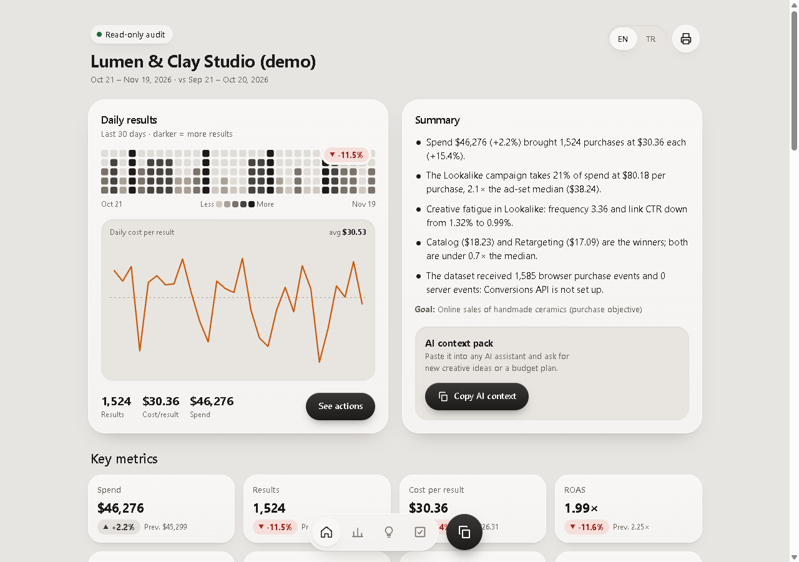
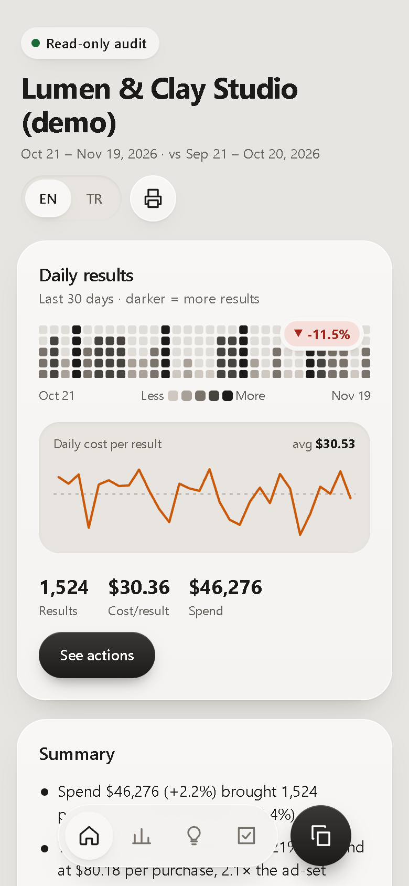

# meta-ads-audit

A free, open-source **Claude Code plugin** that audits your Meta (Facebook / Instagram) ad account, **read-only**, and writes five files: an account report, prioritized recommendations, an AI context pack, technical tasks and a visual HTML report.

No server, no developer app, no API keys. Data comes from Meta's own ads MCP server (`https://mcp.facebook.com/ads`) after you sign in with your own Facebook account. Your own Claude does the analysis.

<p align="center">
  
  
</p>

_Screenshots use the fully fictional demo in [`examples/demo-output/`](examples/demo-output/). Open [`report.html`](examples/demo-output/report.html) in any browser to try it; it has an EN / TR switch._

## Install

In Claude Code:

```
/plugin marketplace add bertugbodur/meta-ads-audit
/plugin install meta-ads-audit@meta-ads-audit
```

Then connect your ad account:

```
/mcp   → meta-ads → Authenticate
```

Sign in with Facebook and pick the ad accounts you want Claude to see. Then just ask:

```
Audit my Meta ad account
```

## What you get

Everything is written to `reports/<account>-<YYYY-MM-DD>/`, in the language you write in, with numbers in your account's currency.

| File | What it is |
|---|---|
| `01-account-report.md` | Summary, KPI table (last 30 days vs previous 30), campaigns, top and bottom ads, breakdown outliers, trends, data gaps |
| `02-recommendations.md` | Up to 10 actions, ordered by priority, each with the finding (and its number), action, impact and effort |
| `03-ai-context.md` / `.json` | A self-contained context pack to paste into any AI assistant for creative ideas or a budget plan |
| `04-technical-tasks.md` | Checklist for Pixel / Conversions API (with `event_id` deduplication), UTMs and other tracking fixes tied to the findings |
| `report.html` | One offline file you open in a browser: heat map, KPIs, campaign cards, recommendations, checklist, segments, "Copy AI context" button, print to PDF |

Raw API responses are saved under `data/` so every number can be traced back.

## Read-only and private

- The skill **never** calls tools that create, update, delete, pause or change budgets, bids or targeting. If you ask for a change, Claude spells out exactly what would change and waits for your explicit confirmation.
- **Your data stays between Meta and your own Claude.** The plugin has no server, no analytics and no telemetry. `report.html` makes no network requests.
- Every finding comes with a number from your data. Missing data is marked "No data"; nothing is estimated.

## About the rules

The thresholds (for example "frequency above 3 and CTR down more than 20% means creative fatigue") are **generic heuristics**, not industry facts. Claude always compares them with your account's own baseline and labels them as heuristics in the report. See [`skills/meta-ads-audit/SKILL.md`](skills/meta-ads-audit/SKILL.md) for the full list.

## Repository layout

```
.claude-plugin/        plugin.json, marketplace.json
.mcp.json              Meta's ads MCP server
skills/meta-ads-audit/
  SKILL.md             the audit workflow
  templates/report.html  the visual report template (schema documented at the top)
examples/demo-output/  fictional example of all 5 outputs
```

## Contributing

Issues and pull requests are welcome: new heuristics, better report sections, more interface languages (add a block to `I18N` in `report.html`). Please keep the plugin read-only and never commit real account data.

## Disclaimer

Not affiliated with, endorsed or sponsored by Meta Platforms, Inc. "Meta", "Facebook" and "Instagram" are trademarks of Meta Platforms, Inc. and are used here only to describe what the plugin works with.

## License

[MIT](LICENSE)
